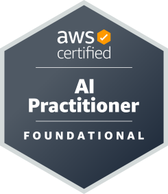
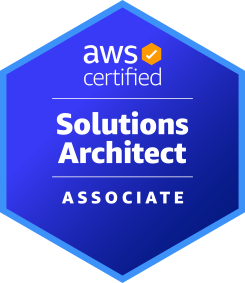

# Software Engineer

사용자에게 가치 있는 제품을 만들자

## 경력

### [김캐디](https://kimcaddie.com/) iOS 엔지니어
*2022.06 - 2026.03*
- 스크린 골프 예약 서비스 김캐디의 프로덕트 팀에서 iOS 개발 리드를 맡았습니다.
- 스크린 골프장 예약, 골프 연습장 예약, 골프 레슨 등 핵심 기능의 개발 및 유지보수 전반을 관리하며 품질과 효율성을 높였습니다.

### [Blind](https://www.teamblind.com/) iOS 엔지니어
*2021.08 - 2022.06*
- 익명 직장인 커뮤니티 플랫폼 Blind의 Growth Community 팀에서 근무했습니다.
- 미국 시장 사용자를 위한 Blind iOS 앱의 기능 개발 및 유지보수를 담당했습니다.

 

## 대외 활동
### Nexters 26기 운영진
*2024.09 - 2025.02*
- 웹사이트: [Nexters](https://nexters.co.kr/)

### Nexters 25기 iOS 개발자
*2024.07 - 2024.09*
- 프로젝트: [Mohanyang](https://github.com/Nexters/Mohanyang-iOS)

### Depromeet 11기 iOS 개발자
*2022.03 - 2022.07*
- 프로젝트: [Tiki-taka](https://github.com/depromeet/Tiqui-Taca_iOS)

 

## 최근 블로그 글

<!-- BLOG-POST-LIST:START -->
- [정적 블로그에도 라우터가 필요한 이유](https://devminseok.github.io/tech-blog-swift/posts/type-safe-routing-for-static-sites/) 2026.08.27
- [Swift 6의 Sendable을 작게 이해하기](https://devminseok.github.io/tech-blog-swift/posts/understanding-swift-sendable/) 2026.08.18
- [Swift로 정적 사이트 생성기 만들기](https://devminseok.github.io/tech-blog-swift/posts/building-a-static-site-with-swift/) 2026.08.10
<!-- BLOG-POST-LIST:END -->

 

## 기술 스택

### iOS

### FE

### BE

 

## 자격증

 

 

## 학력

- **숭실대학교 디지털미디어학과** 
*2025.03 - 재학중*

- **대구소프트웨어마이스터고등학교 소프트웨어개발과** 
*2019.03 - 2022.02*
  
 

## 연락처

